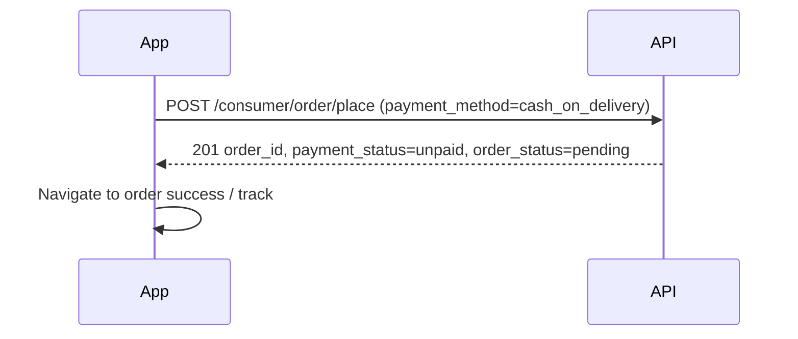
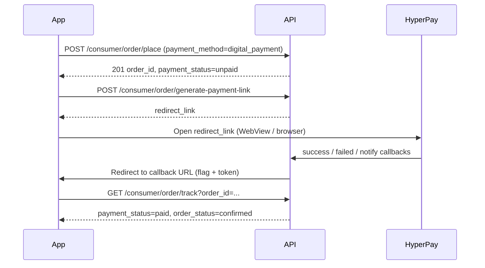

# Gizra Consumer — Payment Integration Guide

**Audience:** Mobile / frontend developers  
**Backend:** Node.js (`gizra-backend`)  
**Gateway:** HyperPay (Israel) for card / digital checkout  
**Last updated:** March 2026  

This document describes how to implement **checkout and payment** in the customer app. Share this file with your developer; Swagger (`swagger-customer.json`) has additional examples under **Consumer Digital Payment (HyperPay)**.

---

## 1. Base URLs

| Environment | API prefix | Payment pages (no `/api`) |
|-------------|------------|-----------------------------|
| Production | `https://backend-prod.gizra.app/api` | `https://backend-prod.gizra.app/payment/hyperpay/...` |
| Local | `http://localhost:3000/api` | `http://localhost:3000/payment/hyperpay/...` |

All **JSON APIs** below use the **API prefix**.  
HyperPay **redirect URLs** returned from the backend use the **host only** (no `/api`).

---

## 2. Supported payment methods (customer checkout)

| User selects | `payment_method` on **place order** | What happens next |
|--------------|-------------------------------------|-------------------|
| Cash on delivery | `cash_on_delivery` | Order created → done (no second step) |
| Card / online | `digital_payment` | Order created **unpaid** → **generate payment link** → open HyperPay → wait for success |
| Wallet | `wallet` | Order created **paid** + **confirmed** (only if enabled in admin settings) |

**Important:** Place order and payment link use **different** method strings:

- Place order: `digital_payment`
- Generate link: `hyper_pay`

Do not send `hyper_pay` on place order, and do not send `digital_payment` on generate-payment-link.

---

## 3. Discover what the app should show (config)

Before checkout, read app config (public):

```http
GET /api/consumer/config
```

Relevant flags:

| Field | Meaning |
|-------|---------|
| `cash_on_delivery` | Show COD if `true` |
| `digital_payment` | Show card / online if `true` |
| `digital_payment_info.digital_payment` | Same idea for digital |
| `customer_wallet_status` | Wallet UI if non-zero / enabled |
| `guest_checkout_status` | Guest can place orders (see auth notes) |

---

## 4. Authentication

| Endpoint | Auth |
|----------|------|
| `POST /api/consumer/order/place` | **Bearer JWT** (registered user **or** guest token, depending on cart flow) |
| `POST /api/consumer/order/generate-payment-link` | **Registered customer JWT only** — **guest is rejected** (`401 Login required`) |
| `GET /api/consumer/order/track` | Bearer (or guest params per track API docs) |

**Digital / card checkout:** user must be **logged in** (not guest) to get a payment link.

Header:

```http
Authorization: Bearer <access_token>
Content-Type: application/json
```

---

## 5. Flow A — Cash on delivery (single step)



### Request

```http
POST /api/consumer/order/place
Authorization: Bearer {{token}}
Content-Type: application/json
```

```json
{
  "restaurant_id": 4,
  "payment_method": "cash_on_delivery",
  "order_type": "delivery",
  "distance": 2.5,
  "delivery_address_id": 12,
  "dm_tips": 0,
  "coupon_code": ""
}
```

(Cart can come from DB cart, or pass `is_buy_now` + `cart` / `items` — same as existing cart integration.)

### Success response (201)

```json
{
  "status": true,
  "msg": "Order placed successfully",
  "message": "Order placed successfully",
  "order_id": "100042",
  "total_ammount": 45.5,
  "data": {
    "id": "100042",
    "payment_status": "unpaid",
    "order_status": "pending",
    "payment_method": "cash_on_delivery",
    "order_amount": 45.5,
    "restaurant_id": "4"
  }
}
```

**UI:** Treat as success; open track / order details. Payment is collected on delivery.

---

## 6. Flow B — Card / digital (HyperPay) — two steps



### Step 1 — Place order (unpaid)

```http
POST /api/consumer/order/place
```

```json
{
  "restaurant_id": 4,
  "payment_method": "digital_payment",
  "order_type": "delivery",
  "distance": 2.5,
  "delivery_address_id": 12
}
```

Expect:

- `data.payment_status`: **`unpaid`**
- `data.order_status`: **`pending`**
- `data.payment_method`: **`digital_payment`**

Save **`order_id`** from the response.

### Step 2 — Get checkout URL

```http
POST /api/consumer/order/generate-payment-link
Authorization: Bearer {{token}}
Content-Type: application/json
```

```json
{
  "order_id": 100042,
  "payment_method": "hyper_pay",
  "callback": "gizra://payment-result",
  "payment_platform": "app"
}
```

| Body field | Required | Values |
|------------|----------|--------|
| `order_id` | Yes | From place-order response |
| `payment_method` | Yes | **`hyper_pay`** (only supported gateway today) |
| `callback` | Yes | Your deep link or HTTPS return URL |
| `payment_platform` | No | **`app`** (default) or **`web`** |

### Success response (200)

```json
{
  "redirect_link": "https://backend-prod.gizra.app/payment/hyperpay/pay?payment_id=550e8400-e29b-41d4-a716-446655440000"
}
```

### Step 3 — Open payment

- Open **`redirect_link`** in **in-app WebView** or system browser.
- Backend responds with **302** to HyperPay hosted page (`https://pay.hyp.co.il/p/...`).
- User completes payment on HyperPay.

**Do not** call HyperPay APIs directly from the app; only open `redirect_link`.

### Step 4 — Return to app (callback URL)

After payment, the backend redirects the user to your **`callback`** with query parameters:

```text
gizra://payment-result?flag=success&&token=<base64>
gizra://payment-result?flag=fail&&token=<base64>
```

| Query | Meaning |
|-------|---------|
| `flag` | `success` or `fail` |
| `token` | Base64 string (legacy PHP parity). Decoded UTF-8 looks like: `payment_method=hypay&&attribute_id=<order_id>&&transaction_reference=<gateway_tx_id>` |

**Mobile implementation tips:**

1. Register deep link / universal link for `callback` host/scheme.
2. Intercept navigation in WebView when URL matches your callback.
3. Parse `flag`; on `success`, refresh order via **track** API (do not trust UI alone).
4. On `fail`, show retry: call **generate-payment-link** again with same `order_id` (if still unpaid).

### Step 5 — Confirm order state (source of truth)

```http
GET /api/consumer/order/track?order_id=100042
Authorization: Bearer {{token}}
```

After successful payment, expect:

- `payment_status`: **`paid`**
- `order_status`: **`confirmed`**

If still `unpaid` after `flag=success`, poll track a few times (webhook may be slightly delayed).

---

## 7. Flow C — Wallet (optional)

If `customer_wallet_status` / wallet is enabled:

```json
{
  "payment_method": "wallet",
  "restaurant_id": 4,
  "order_type": "take_away",
  "distance": 0
}
```

On success, response typically has:

- `payment_status`: **`paid`**
- `order_status`: **`confirmed`**

Errors:

- `203` — insufficient balance (`order_amount` code in legacy responses)

**Note:** Confirm wallet behavior with QA on staging before shipping wallet UI in production.

---

## 8. Order status reference (payment-related)

| Stage | `payment_method` (on order) | `payment_status` | `order_status` |
|-------|------------------------------|------------------|----------------|
| After place (COD) | `cash_on_delivery` | `unpaid` | `pending` |
| After place (digital) | `digital_payment` | `unpaid` | `pending` |
| After HyperPay success | stored as gateway (`hypay` / similar) | `paid` | `confirmed` |
| After place (wallet) | `wallet` | `paid` | `confirmed` |
| HyperPay failed | may update to failed flow | `unpaid` | `failed` |

---

## 9. Backend-only routes (no app call required)

These are used by HyperPay and browsers; document for DevOps / debugging only:

| Method | URL | Purpose |
|--------|-----|---------|
| GET | `/payment/hyperpay/pay?payment_id={uuid}` | Starts checkout (302 to HyperPay) |
| ALL | `/payment/hyperpay/success` | Success return + verification |
| ALL | `/payment/hyperpay/failed` | Failure return |
| ALL | `/payment/hyperpay/notify` | Server notify/webhook |

Registered with HyperPay using **`API_PUBLIC_URL`** on the server (e.g. `https://backend-prod.gizra.app`).

---

## 10. Error handling (common)

| HTTP | When | App action |
|------|------|------------|
| `400` | Invalid place-order body | Show validation message |
| `401` | Missing/invalid token | Login |
| `401` | Guest on generate-payment-link | Force login before card pay |
| `403` | Digital/wallet/COD disabled in settings | Hide method or show message |
| `404` | generate-payment-link: order not found or already paid | Go to order details |
| `500` | HyperPay not configured / signing failed | Retry later; contact support |

Place-order business errors often return **`203`** with a message (e.g. minimum order, COD limit, insufficient wallet).

---

## 11. Postman checklist

1. Login → copy Bearer token.  
2. `POST {{base}}/consumer/order/place` with `digital_payment`.  
3. `POST {{base}}/consumer/order/generate-payment-link` with `hyper_pay` + `callback`.  
4. Open `redirect_link` in browser (complete test card on HyperPay sandbox if available).  
5. `GET {{base}}/consumer/order/track?order_id=...` → verify `paid` / `confirmed`.

Replace `{{base}}` with `https://backend-prod.gizra.app/api` or local.

---

## 12. UI recommendations

1. **Checkout screen:** Load `/consumer/config` → show COD / digital / wallet toggles from flags.  
2. **Digital:** After place order, automatically open payment WebView; don’t leave user on “unpaid” without explanation.  
3. **Loading states:** Between HyperPay return and track API, show “Confirming payment…”.  
4. **Retry:** On `flag=fail`, offer “Try again” → new `generate-payment-link` for same `order_id` if still unpaid.  
5. **Deep link:** Use a dedicated route, e.g. `gizra://payment-result`, not the home screen.  
6. **Security:** Never embed HyperPay secrets in the app; only use `redirect_link` from backend.

---

## 13. Also available (ported from PHP)

These customer APIs are now on Node. Use them if the app already has UI:

- Wallet history / bonuses / **add fund** via HyperPay: `GET /consumer/wallet/transactions`, `GET /consumer/wallet/bonuses`, `POST /consumer/wallet/add-fund`
- Offline payment submit + method list: `PUT /consumer/order/offline-payment`, `GET /consumer/config/offline-payment-methods`
- Switch unpaid digital order to COD: `PUT /consumer/order/payment-method`

Still not in scope:

- **Partial payment** on place order
- Multiple gateways (Stripe, PayPal, etc.) — only **`hyper_pay`**
- Guest users completing **card** payment (must register/login)

---

## 14. Quick copy-paste summary for implementer

```text
COD:     POST /api/consumer/order/place  →  payment_method: cash_on_delivery  →  done

Card:    POST /api/consumer/order/place  →  payment_method: digital_payment
         POST /api/consumer/order/generate-payment-link  →  payment_method: hyper_pay, callback, payment_platform: app
         Open redirect_link  →  handle callback ?flag=&token=
         GET /api/consumer/order/track  →  confirm payment_status=paid

Config:  GET /api/consumer/config  →  cash_on_delivery, digital_payment, customer_wallet_status
Auth:    Bearer on all order endpoints; generate-payment-link requires registered user (no guest)
```

---

## 15. Backend checklist (for mobile / QA)

| Item | Status |
|------|--------|
| `GET /api/consumer/config/` flat JSON with `cash_on_delivery`, `digital_payment`, `digital_payment_info.digital_payment` | Implemented (`buildAppConfiguration`) |
| Payment flags read legacy JSON `{"status":"1"}` or `{"status":1}` | Fixed in Node (matches PHP `status == 1`) |
| Platform DB: enable COD + digital | `business_settings` keys `cash_on_delivery`, `digital_payment` → run `npm run seed:business-settings` or legacy admin **Payment** toggles |
| **Prod** must run latest backend after DB update | Until deploy, prod may still return both flags `false` despite DB |
| `POST /consumer/order/place` | `cash_on_delivery` or `digital_payment` |
| `POST /consumer/order/generate-payment-link` | **`hyper_pay` only**; body: `order_id`, `callback` (e.g. `gizra://payment-result`), `payment_platform`: `"app"` |
| Success body | `{ "redirect_link": "https://…/payment/hyperpay/pay?payment_id=…" }` |
| Guest JWT on generate-payment-link | **401** `"Login required"` (registered customer only) |
| After HyperPay | `GET /consumer/order/track?order_id=…` → `payment_status`: `"paid"` when successful |
| HyperPay env on server | `API_PUBLIC_URL`, `HYP_MASOF`, `HYP_PASSP`, `HYP_API_KEY`, `HYP_BASE_URL` |
| Debug failed WebView checkout | SSH: `docker logs -f gizra-backend \| grep hyperpay` — tags: `pay_incoming`, `apisign_response`, `failed_callback`, `failed_processing`, `verify_callback`, `final_response` |

**App UI rule (confirmed with mobile):** If `cash_on_delivery` is `false`, hide COD and show card/HyperPay only when `digital_payment` (or `digital_payment_info.digital_payment`) is `true`. Both `false` → no valid checkout method until admin enables at least one.

---

## 16. Questions / support

- API contract: `gizra-backend/swagger-customer.json`  
- Server env (DevOps): `API_PUBLIC_URL`, `HYP_MASOF`, `HYP_PASSP`, `HYP_API_KEY`, `HYP_BASE_URL`  
- Product owner for wallet / partial pay roadmap

---

*End of document.*
