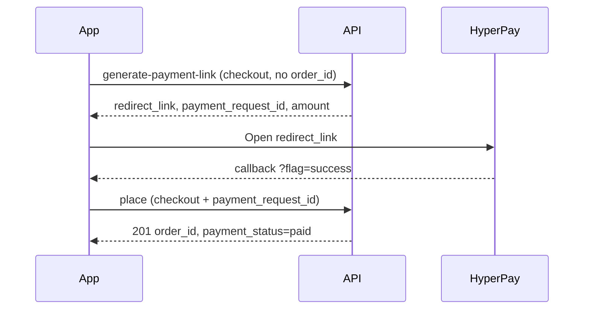

# Gizra Customer App — Checkout & Payment (Frontend Guide)

**For:** Mobile (Flutter/React Native) and web frontend developers  
**API:** `gizra-backend` — base path `/api`  
**Card gateway:** HyperPay (`hyper_pay`)  
**Updated:** October 2026  

Use this document to wire checkout UI to the Node backend. For full API schemas, see `swagger-customer.json` in the same repo.

---

## Base URL & headers

| Environment | API base |
|-------------|----------|
| Production | `https://backend-prod.gizra.app/api` |
| Local | `http://localhost:3000/api` |

Every authenticated request:

```http
Authorization: Bearer <access_token>
Content-Type: application/json
```

Payment **redirect** URLs use the host **without** `/api` (e.g. `https://backend-prod.gizra.app/payment/hyperpay/pay?payment_id=...`).

---

## Payment method strings (do not mix them up)

| Step | Endpoint | Field | Value |
|------|----------|-------|--------|
| Place order (COD / wallet / after card pay) | `POST /consumer/order/place` | `payment_method` | `cash_on_delivery`, `wallet`, or `digital_payment` |
| Start HyperPay | `POST /consumer/order/generate-payment-link` | `payment_method` | **`hyper_pay`** only |

Never send `hyper_pay` on place order. Never send `digital_payment` on generate-payment-link.

---

## Which flow to implement

| User choice | Flow | Summary |
|-------------|------|---------|
| Cash on delivery | **A** | One call: place order |
| Card / online | **B1 (recommended)** | Pay first → then place order with `payment_request_id` |
| Card / online | **B2 (legacy)** | Place unpaid order → pay with `order_id` — keep only if old app versions need it |
| Wallet | **C** | One call: place order with `wallet` |

**New apps should use B1 only** for card checkout. You do **not** need an `order_id` before opening HyperPay.

---

## Flow A — Cash on delivery

```http
POST /api/consumer/order/place
```

```json
{
  "restaurant_id": 4,
  "payment_method": "cash_on_delivery",
  "order_type": "delivery",
  "distance": 2.5,
  "delivery_address_id": 12,
  "dm_tips": 0,
  "coupon_code": ""
}
```

**Success (201):** use `order_id` and navigate to order success / track.

**Cart:** Either server cart (user already added items via cart APIs) or buy-now:

```json
{
  "is_buy_now": true,
  "cart": [
    {
      "item_id": 10,
      "quantity": 2,
      "add_on_ids": [],
      "add_on_qtys": [],
      "variations": []
    }
  ]
}
```

---

## Flow B1 — Card / HyperPay (payment first) — **recommended**

### Sequence

1. User taps **Pay with card** on checkout.
2. **`POST /consumer/order/generate-payment-link`** — full checkout body, **no `order_id`**.
3. Store **`payment_request_id`** and open **`redirect_link`** in WebView / browser.
4. User pays on HyperPay; app receives **callback** with `flag=success` or `flag=fail`.
5. On success: **`POST /consumer/order/place`** — **same checkout body** as step 2, plus **`payment_request_id`**.
6. Show success with `order_id` from place-order response.



### Step 1 — Generate payment link

```http
POST /api/consumer/order/generate-payment-link
Authorization: Bearer {{token}}
```

```json
{
  "restaurant_id": 4,
  "order_type": "delivery",
  "distance": 2.5,
  "delivery_address_id": 12,
  "dm_tips": 0,
  "coupon_code": "",
  "payment_method": "hyper_pay",
  "callback": "gizra://payment-result",
  "payment_platform": "app"
}
```

| Field | Required | Notes |
|-------|----------|--------|
| Checkout fields | Yes | Same as place order: `restaurant_id`, `order_type`, `distance` (delivery), address or `delivery_address_id`, cart/buy-now, tips, coupon, etc. |
| `order_id` | **No** | Omit for B1 |
| `payment_method` | Yes | `hyper_pay` |
| `callback` | Yes | Deep link or HTTPS return URL |
| `payment_platform` | No | `app` (default) or `web` |

**Auth:** Registered customer only. Guest JWT → **401** `Login required`. Prompt login before card pay.

**Success (200):**

```json
{
  "redirect_link": "https://backend-prod.gizra.app/payment/hyperpay/pay?payment_id=550e8400-e29b-41d4-a716-446655440000",
  "payment_request_id": "550e8400-e29b-41d4-a716-446655440000",
  "amount": 45.5
}
```

**Frontend must persist until place order succeeds:**

- `payment_request_id` (primary key for step 2)
- Full checkout payload (same JSON you sent in step 1)
- Optional: parse `payment_id` from `redirect_link` query if you only stored the URL

### Step 2 — Open HyperPay

- Load `redirect_link` in WebView or external browser.
- Do **not** call HyperPay APIs from the app; only follow the backend URL.
- Backend redirects to `https://pay.hyp.co.il/p/...`.

### Step 3 — Handle return URL

After payment, the user is redirected to your `callback`:

```text
gizra://payment-result?flag=success&&token=<base64>&&payment_request_id=<uuid>&&requires_place_order=1&&checkout_flow=payment_first
gizra://payment-result?flag=fail&&token=<base64>
```

| Query | Action |
|-------|--------|
| `flag=success` + `requires_place_order=1` | HyperPay OK only — call **step 4** before showing order success. |
| `flag=success` + `checkout_flow=order_first` + `order_id` | Legacy B2 — poll track until `payment_status` is `paid`. |
| `flag=fail` | Show error; user can retry step 1 (new payment link). |

**Note:** `flag=success` is **not** `payment_status: paid` on an order. For B1, use `payment_request_id` from the callback query or your saved value from step 1.

### Step 4 — Finish order after successful payment

**Option A (recommended for apps)** — server replays checkout saved at payment-link time:

```http
POST /api/consumer/order/complete-checkout-payment
Authorization: Bearer {{token}}
Content-Type: application/json

{ "payment_request_id": "550e8400-e29b-41d4-a716-446655440000" }
```

**Option B** — full checkout body (same as step 1):

```http
POST /api/consumer/order/place
Authorization: Bearer {{token}}
```

Use the **identical** checkout object from step 1, with these changes:

```json
{
  "restaurant_id": 4,
  "order_type": "delivery",
  "distance": 2.5,
  "delivery_address_id": 12,
  "payment_method": "digital_payment",
  "payment_request_id": "550e8400-e29b-41d4-a716-446655440000"
}
```

| Field | Required | Notes |
|-------|----------|--------|
| `payment_method` | Yes | `digital_payment` |
| `payment_request_id` | Yes | From generate-payment-link response |
| Checkout fields | Yes | Must match what was used to generate the link (totals are re-validated server-side) |

**Success (201):**

```json
{
  "status": true,
  "order_id": "105",
  "data": {
    "id": "105",
    "payment_status": "paid",
    "order_status": "pending",
    "payment_method": "hypay"
  }
}
```

`order_status` stays **`pending`** until the restaurant accepts (same as COD). `payment_status` is **`paid`**.

**Common errors on place (403):**

| Message | Cause |
|---------|--------|
| Payment not completed | User returned before HyperPay finished; retry payment |
| Payment already used | Same `payment_request_id` placed twice — go to orders list |
| Order total does not match paid amount | Checkout payload changed between step 1 and 4 — rebuild checkout and pay again |
| Card payment is already completed… | You paid HyperPay but called place **without** `payment_request_id` — see **Recovery** below |

### Recovery — paid HyperPay but order still `unpaid`

If the app created order **405** without `payment_request_id` after a successful callback:

```http
POST /api/consumer/order/attach-checkout-payment
Authorization: Bearer {{token}}
```

```json
{
  "order_id": 405,
  "payment_request_id": "016178d7-b137-4b87-8cba-7ac68ee0648d"
}
```

Or call **place order again** with the **same checkout body** plus `payment_request_id` (creates a new paid order; cancel the orphan unpaid order in admin if needed).

**Prevention (app):** After `flag=success`, always place with `payment_request_id`. Check `data.payment_status === "paid"` in the place-order response before showing success.

### B1 — Frontend state checklist

- [ ] Keep checkout payload in memory / secure storage from “Pay” until place order returns.
- [ ] Keep `payment_request_id` tied to that payload.
- [ ] On WebView destroy without callback, do not call place order; let user retry payment.
- [ ] On success, clear stored checkout + `payment_request_id` after receiving `order_id`.
- [ ] Idempotency: if place order fails with network error after payment succeeded, **retry place order with the same `payment_request_id`** (payment is consumed only once an order is created).

---

## Flow B2 — Card (legacy: order first)

Only for older app versions.

1. `POST /consumer/order/place` with `payment_method: digital_payment` → save `order_id`, `payment_status: unpaid`.
2. `POST /consumer/order/generate-payment-link` with `{ "order_id": 105, "payment_method": "hyper_pay", "callback": "...", "payment_platform": "app" }`.
3. Open `redirect_link`, handle callback.
4. `GET /consumer/order/track?order_id=105` until `payment_status` is `paid`.

---

## Flow C — Wallet

```json
{
  "restaurant_id": 4,
  "payment_method": "wallet",
  "order_type": "take_away",
  "distance": 0
}
```

**203** = insufficient balance.

---

## Place order — shared checkout fields

Delivery orders typically need:

| Field | Delivery | Take away |
|-------|----------|-----------|
| `restaurant_id` | Required | Required |
| `order_type` | `delivery` | `take_away` |
| `distance` | Required (km) | Optional / 0 |
| `delivery_address_id` | Or inline address | N/A |
| `address`, `latitude`, `longitude` | If no `delivery_address_id` | N/A |

Optional: `order_note`, `dm_tips`, `coupon_code`, `schedule_at`, `cutlery`, `delivery_instruction`, `guest_id` (guest checkout on place only — not for card pay).

Validate coupon before checkout: `GET /consumer/coupon/apply?code=...&restaurant_id=...`

---

## Config — what to show on checkout screen

```http
GET /api/consumer/config
```

| Flag | UI |
|------|-----|
| `cash_on_delivery` | Show COD |
| `digital_payment` or `digital_payment_info.digital_payment` | Show card |
| `customer_wallet_status` | Show wallet |
| `guest_checkout_status` | Allow guest place for COD; **card still requires login** |

If both COD and digital are false, block checkout and show “Payment unavailable”.

---

## Error handling (frontend)

| HTTP | Endpoint | UX |
|------|----------|-----|
| 400 | place / generate-link | Show `msg` from body |
| 401 | Any | Login |
| 401 | generate-payment-link | “Please log in to pay by card” |
| 403 | place with `payment_request_id` | Payment / amount issues (see table above) |
| 404 | generate-link (B2) | Order missing or already paid |
| 203 | place | Business rules (min order, COD limit, wallet) |

Response shape (typical):

```json
{ "status": false, "msg": "Human readable message" }
```

---

## UI recommendations

1. **Card checkout:** Use B1 — never ask the user for an “order id” before payment.
2. **Loading:** After `flag=success`, show “Creating your order…” until place order returns.
3. **Deep link:** Dedicated route for `callback`, not home screen.
4. **Retry failed card pay:** Call generate-payment-link again with the same checkout body (new `payment_request_id`).
5. **Secrets:** No HyperPay keys in the app — only `redirect_link` from the API.

---

## Quick reference (copy-paste)

```text
COD:
  POST /api/consumer/order/place
  payment_method: cash_on_delivery

CARD (recommended):
  POST /api/consumer/order/generate-payment-link
    → checkout fields + payment_method: hyper_pay + callback
    → save payment_request_id + checkout snapshot
  Open redirect_link
  On callback flag=success:
  POST /api/consumer/order/place
    → same checkout + payment_method: digital_payment + payment_request_id

WALLET:
  POST /api/consumer/order/place
  payment_method: wallet

CONFIG:
  GET /api/consumer/config
```

---

## Related docs

- Longer guide (includes backend QA): `CONSUMER_PAYMENT_INTEGRATION.md`
- OpenAPI: `gizra-backend/swagger-customer.json` — tag **Consumer Digital Payment (HyperPay)**

---

*Questions: share `order_id` or `payment_request_id` and timestamp with backend when debugging failed checkouts.*
